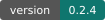
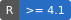
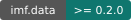
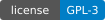
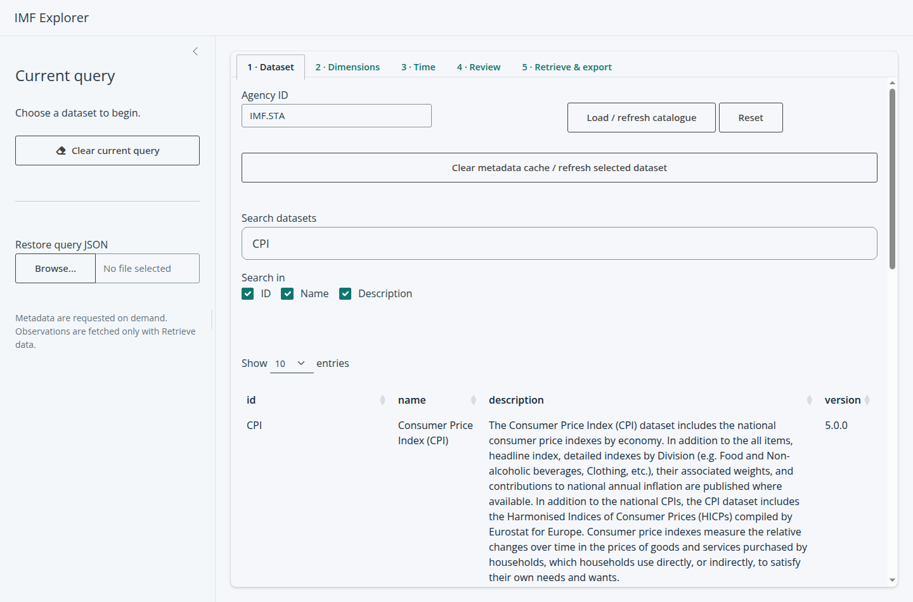
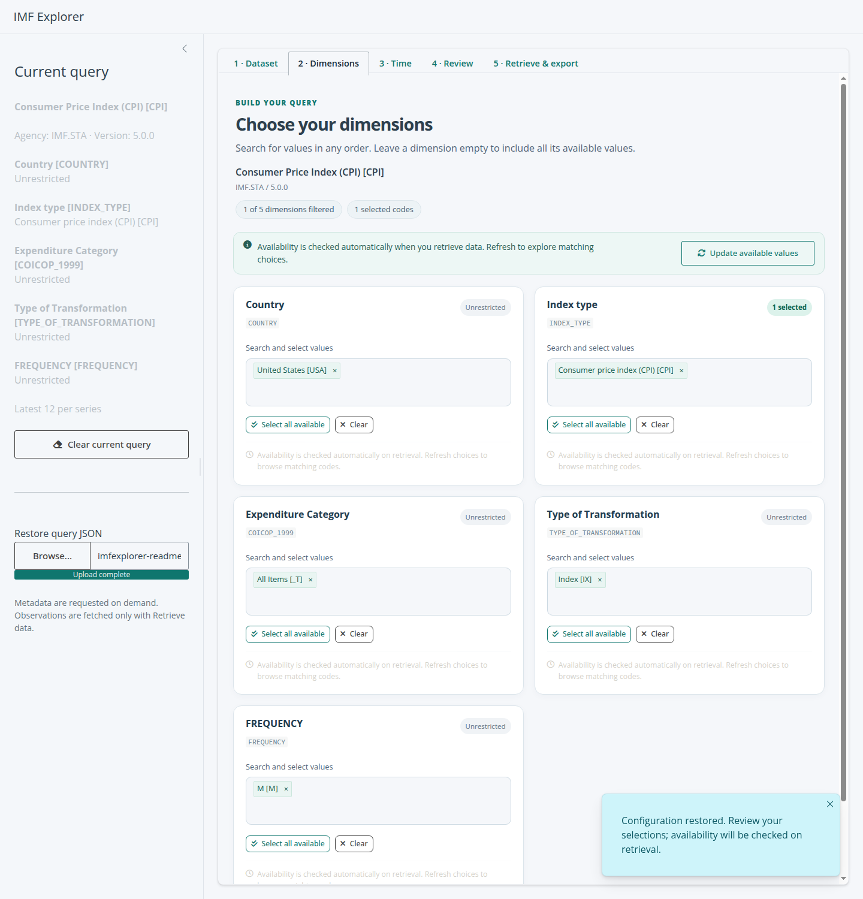
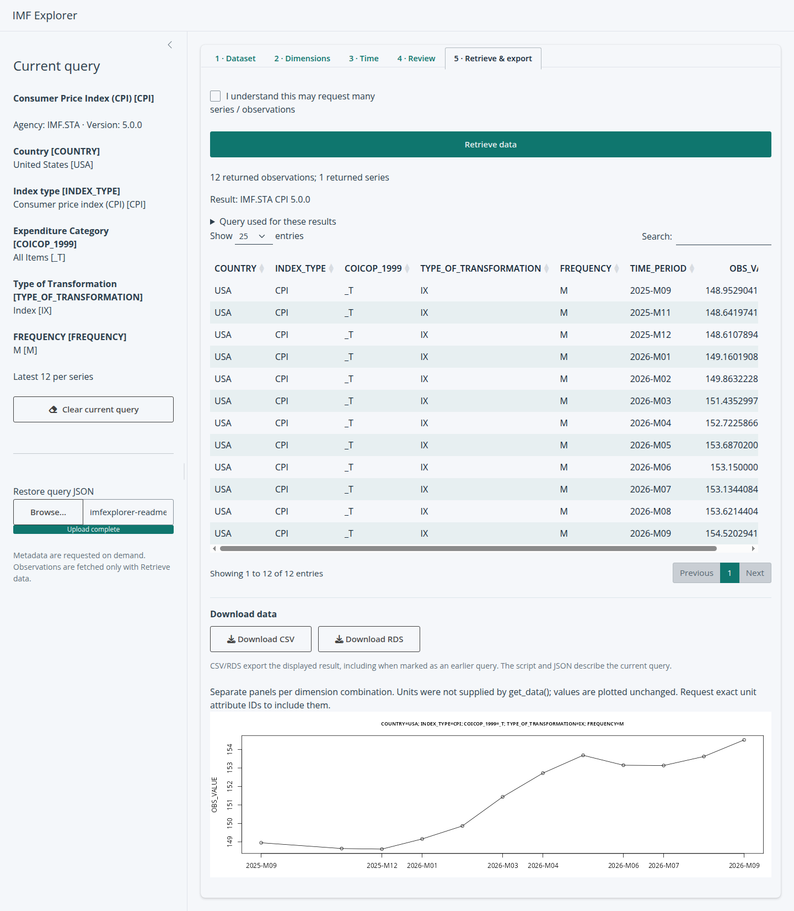

# imfexplorer

[](DESCRIPTION)
[](https://www.r-project.org/)
[](https://pedrobtz.github.io/imf.data/)
[](https://www.gnu.org/licenses/gpl-3.0.html)

Explore IMF datasets visually, choose dimension values, and download data through a Shiny app powered by [imf.data](https://pedrobtz.github.io/imf.data/).

## Install and open

Requires **R 4.1 or later** and **imf.data 0.2.0 or later**. Required package dependencies are installed automatically.

```r
install.packages("remotes") # Only needed once
remotes::install_github("karamelikli/imfexplorer")
imfexplorer::imfexplorer()
```

The app opens with agency `IMF.STA`. To use another agency, pass its ID with `agency_id` when launching.

## A quick tour

### 1. Find a dataset

Search dataset IDs, names or descriptions, then select a row to explore its dimensions.



### 2. Choose values and time options

Search and select codes in each dimension card. Use **Select all available**, remove individual items with **x**, or **Clear** a selection. An empty dimension means unrestricted.

**Update available values** helps you browse codes matching your other selections. Availability is also checked automatically when you retrieve data. Unavailable selected codes stay visible so you can correct them.

Choose **All periods**, a **Period range**, or **Latest N per series**, then review the generated query.



### 3. Retrieve and export

Click **Retrieve data** to download observations. Browse the table, view a time-series plot when supported, and download **CSV** or **RDS** below the table.



*Screenshots captured on 3 November 2026 using live IMF CPI data: USA, monthly frequency, latest 12 observations. Available datasets, versions and observations can change.*

## Save and reuse a query

- **R script:** download runnable code from the Review tab.
- **Query JSON:** save your selections and restore them later with **Restore query JSON** in the sidebar.
- **CSV / RDS:** export the retrieved observations from Retrieve & export.

Selections remain editable. If you change a query after retrieval, existing results are marked **EARLIER QUERY** until you retrieve again. **Clear current query** starts a new selection.

## Useful tips

- Empty dimensions and unrestricted time ranges can produce large requests; acknowledge the warning before retrieving.
- **Latest N** applies to each series, not the total number of returned rows.
- If a plot is unsuitable, the data table and downloads remain available.
- After updating the package, stop the old app and restart R before launching again.

For source installation, package structure and development checks, see [CONTRIBUTING.md](CONTRIBUTING.md).

## License

GPL-3.
